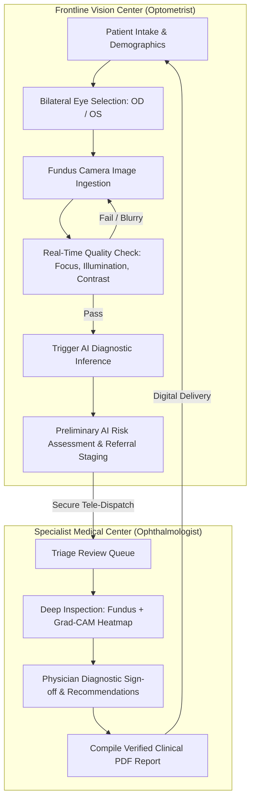

<div align="center">

# Retinova Clinical Portal: Tele-Ophthalmology Web Application

**Modern React 19 Clinical Workstation for AI-Assisted Retinal Screening, Diagnostic Triage, and Specialist Tele-Consultation.**

[](src/)
[](src/App.css)
[-3da87a?style=for-the-badge&logo=vite&logoColor=white)](dist/)
[](https://www.sih.gov.in)
[](render.yaml)
[](LICENSE)

</div>

---

## 1. Executive Summary & Clinical Context

Preventable blindness from diabetic retinopathy and glaucoma disproportionately impacts underserved populations due to severe shortages of specialist ophthalmologists in rural primary care centers. **Retinova** addresses this diagnostic bottleneck through a dual-role tele-ophthalmology workflow developed for the **Smart India Hackathon (SIH 2026)**.

The **Retinova Clinical Portal** provides two distinct medical interfaces:
1. **Primary Health Centre (PHC) & Optometrist Interface:** Guides frontline healthcare workers through patient demographic intake, bilateral eye selection (OD/OS), automated image quality pre-checks, AI inference invocation, and immediate risk-stratified triage.
2. **Ophthalmologist Tele-Review Workstation:** Empowers remote retina specialists to review triage queues, inspect full-resolution fundus scans alongside Grad-CAM explainability heatmaps, confirm or modify clinical gradings, and issue legally compliant digital diagnostic reports.

---

## 2. Telemedicine Clinical Workflow



---

## 3. Key Portal Capabilities

- **Bilateral Examination Protocol:** Enforces systematic clinical capture of Right Eye (*Oculus Dexter*, OD) and Left Eye (*Oculus Sinister*, OS).
- **Automated Image Quality Gating:** Analyzes fundus photograph illumination, sharpness, and field centering before dispatching to the AI engine, preventing low-quality false negatives.
- **Explainable AI Integration:** Renders Grad-CAM spatial activation overlays directly on top of fundus photographs, allowing clinicians to verify the exact retinal lesions (e.g. microaneurysms, cotton wool spots, exudates) informing the algorithmic grade.
- **Dual Triage Workspaces:** Separate, role-tailored dashboards with role-based routing (`RoleSelection.jsx`, `DoctorDashboard.jsx`, `PHCDashboard`).
- **Standardized Medical Reporting:** Interactive report generator (`ClinicalReport.jsx`) rendering ICD-10 codes, physician signatures, diagnostic findings, and follow-up timelines ready for one-click printing or PDF export.

---

## 4. Quickstart & Local Installation

### Prerequisites
- Node.js 18.x, 20.x, or 24.x
- npm

### 1. Clone & Install Dependencies
```bash
git clone https://github.com/purnachandra-maharana/retinova-frontend.git
cd retinova-frontend

npm install
```

### 2. Configure Environment Variables
```bash
cp .env.example .env
```
Point `VITE_API_URL` to your running `retinova-backend` instance:
```env
VITE_API_URL=http://localhost:10000
```

### 3. Launch Development Server
```bash
npm run dev
```
Open your browser at `http://localhost:5173`.

---

## 5. Production Build & Deployment (Render Blueprint)

This repository includes an Infrastructure-as-Code manifest (`render.yaml`) optimized for deployment as a **Render Static Site**.

### One-Click Render Deployment
1. Push this repository to GitHub.
2. Open [Render Dashboard](https://dashboard.render.com) > **New +** > **Blueprint**.
3. Select `retinova-frontend`. Render automatically provisions:
   - **Service Type:** Static Site
   - **Build Command:** `npm install && npm run build`
   - **Publish Directory:** `dist`
   - **SPA Routing Rule:** Rewrites all paths to `index.html`
   - **Security Headers:** `X-Frame-Options: SAMEORIGIN`, `X-Content-Type-Options: nosniff`

### Local Production Build Verification
```bash
npm run build
npm run preview
```

---

## 6. Repository Structure

```
retinova-frontend/
├── .github/
│   └── workflows/
│       └── ci.yml               # Automated Vite production build CI
├── public/                      # Static assets & SVG icons
│   ├── favicon.svg
│   └── icons.svg
├── src/
│   ├── assets/                  # Application graphics & design tokens
│   ├── components/              # Shared navigation & layout primitives
│   │   ├── Navbar.jsx
│   │   └── Sidebar.jsx
│   ├── pages/
│   │   ├── auth/Login.jsx       # Clinical provider authentication
│   │   ├── doctor/              # Specialist tele-review interfaces
│   │   │   ├── ClinicalReport.jsx
│   │   │   ├── DoctorCaseReview.jsx
│   │   │   └── DoctorDashboard.jsx
│   │   ├── phc/                 # Frontline vision center workflow
│   │   │   ├── AIAnalysis.jsx
│   │   │   ├── CaptureImage.jsx
│   │   │   ├── ClinicalReport.jsx
│   │   │   ├── EyeSelection.jsx
│   │   │   ├── PatientDetails.jsx
│   │   │   ├── QualityCheck.jsx
│   │   │   └── ScreeningResult.jsx
│   │   ├── Dashboard.jsx
│   │   └── RoleSelection.jsx
│   ├── services/
│   │   └── api.js               # Centralized Axios API client & error envelopes
│   ├── App.css                  # Custom clinical styling & eye logo SVG rules
│   ├── App.jsx                  # Master routing & session controller
│   ├── index.css
│   └── main.jsx
├── .env.example                 # Environment configuration template
├── eslint.config.js             # Code quality configuration
├── index.html                   # HTML entrypoint
├── package.json                 # Dependency manifest
├── render.yaml                  # Render Static Site blueprint
├── vite.config.js               # Vite 8 build configuration
└── README.md                    # Startup-grade technical documentation
```

---

## 7. Security & Tele-Health Privacy

- **Client-Side Data Hygiene:** Sensitive patient records and screening sessions are cleared from client state upon session logout.
- **Secure Transport:** Mandates HTTPS and strict CORS validation when communicating with `retinova-backend`.
- **Frame Protection:** Enforces `X-Frame-Options: SAMEORIGIN` across all routes to prevent clickjacking attacks.

---

## 8. Author & Attribution

**Purna Chandra Maharana**
- Portfolio: [github.com/purnachandra-maharana](https://github.com/purnachandra-maharana)
- Reference Standard: [Inkloom AI](https://github.com/purnachandra-maharana/inkloom-ai)
- Hackathon Project: Smart India Hackathon 2026 (SIH 2026)
